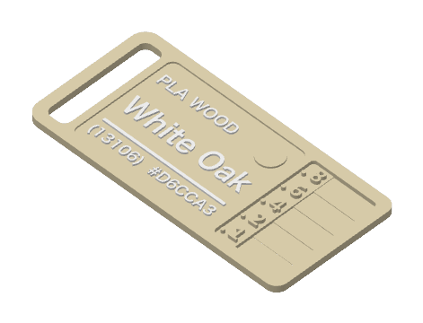
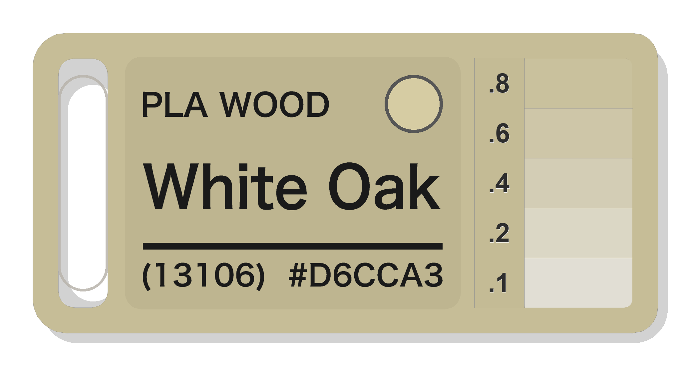
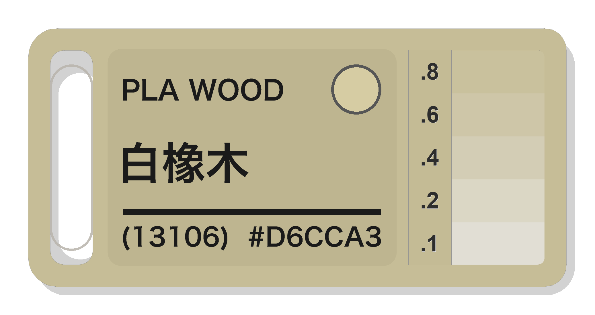

# 🎨 Bambu Lab Filament Card Studio (耗材样本卡生成器)

[](https://ziikki.github.io/filament_card/)
[](https://bambulab.com)
[](LICENSE)
[](#)

A modern, fast, and elegant web application & CLI suite to generate official-dimension 3D printable filament swatch cards for **Bambu Lab** 3D printers. 

Runs **100% client-side** in your browser — zero backend required, free deployment on **GitHub Pages**!

专为 Bambu Lab 3D 打印机打造的现代化耗材样本卡生成工具与在线 Web 应用。**100% 纯前端浏览器运行**，已配置 **GitHub Pages** 免服务器一键部署！

---

## 🌐 Live Demos (在线体验)

- 🇺🇸 **English App**: [https://ziikki.github.io/filament_card/](https://ziikki.github.io/filament_card/)
- 🇨🇳 **中文独立版**: [https://ziikki.github.io/filament_card/zh.html](https://ziikki.github.io/filament_card/zh.html)

*(You can also switch languages dynamically via the top-right button on either page!)*

---

## 🖼️ Card Showcase (整卡渲染与效果展示)

### 1. Bambu Studio 3D 轴测切片效果 (3D Sliced Whole Card)
> 真实 3D 打印切片模型效果，展示包含挂绳孔、0.5mm 平齐嵌色文字与 5 阶透光厚度色块的完整卡体：

<div align="center">
  
</div>

---

### 2. 75mm × 36mm 完整卡片正面效果 (Whole Card Dimensions & Layout)
> 严格对齐 MakerWorld #70155 真实 3D 模型的几何规范：左侧为 6×26mm 圆角挂绳开孔，中间为 40.4×30.4mm 标签凹槽（含文字及色样观察孔），右侧自上而下分布 5 条横向透光测试色样（0.8 / 0.6 / 0.4 / 0.2 / 0.1 mm）及对应的 `.8`、`.6`、`.4`、`.2`、`.1` 刻度浮雕：

| 🇺🇸 PLA Wood - White Oak (13106) | 🇨🇳 PLA Wood - 白橡木 (13106) |
| :---: | :---: |
|  |  |
| 🪓 [Download 3MF (下载 3MF)](examples/耗材样本卡_White_Oak.3mf) | 🪓 [Download 3MF (下载 3MF)](examples/耗材样本卡_白橡木.3mf) |

---

## ✨ Features (核心特性)

1. **100% Static & Client-Side (纯前端生成)**
   - All 3MF mesh generation, contour tracing (Marching Squares), triangulations (Mapbox Earcut), and ZIP archive packaging run directly in the browser via Web APIs.
   - Zero server dependencies, zero cost, works completely offline on GitHub Pages or local browsers.

2. **Clean Light Color Scheme (清爽高雅浅色主题)**
   - Modern, clean slate and white aesthetic inspired by Bambu Lab's official industrial design.
   - Includes a one-click dark theme toggle (☀️ / 🌙) for late-night printing sessions.

3. **Bilingual Support (独立中英文页面 & 动态热切换)**
   - English default (`index.html`) & Chinese default (`zh.html`).
   - Integrated quick toggle `[ 🇨🇳 中文 / 🇺🇸 English ]` without page reload.

4. **Default 0.5 mm Flush Inlay (默认 0.5mm 平齐嵌色)**
   - Pocket floor is at Z = 0.5 mm, top surface is at Z = 1.0 mm. Default relief of **`0.5 mm`** creates text and swatch inlays that are completely flush with the card body for a smooth, seamless touch.
   - Supports adjustable relief up to `1.2 mm` for tactile embossed text.

5. **Official 314-Filament Database (内置 314 款官方耗材库)**
   - Search by color code (e.g. `13106`), English name (`White Oak`), or Chinese name (`白橡木`).
   - Accurate official Bambu Lab hex color codes automatically applied to 3MF metadata and slicer preview.

6. **Store URL Auto-Parser (商城链接一键解析)**
   - Paste any Bambu Lab filament store link (e.g. `https://us.store.bambulab.com/products/pla-wood?id=43075832086664`) to automatically extract material, series variants, and target color swatches.

7. **Bambu Studio & Prime Tower Certified (Bambu Studio 深度兼容)**
   - Watertight 3D mesh with unified layer heights.
   - Fully compatible with the Bambu Studio prime tower (擦料塔) for crisp multi-color transitions without slicing errors.

---

## 📌 Which Repository to Push? (推送仓库目标)

Your remote origin is configured for user **[`ziikki`](https://github.com/ziikki)**:

| Item | Value |
| :--- | :--- |
| **GitHub User** | [`ziikki`](https://github.com/ziikki) |
| **Repository Name** | `filament_card` |
| **Repository URL** | `https://github.com/ziikki/filament_card` |
| **Remote Git URL** | `https://github.com/ziikki/filament_card.git` |
| **Target Branch** | `main` |

### Step-by-Step Push Instructions:

1. **Create the repository on GitHub** (if not created yet):
   - Go to [https://github.com/new](https://github.com/new)
   - Repository name: **`filament_card`**
   - Visibility: **Public**
   - Do **NOT** initialize with README, .gitignore, or license (they are already prepared locally).
   - Click **Create repository**.

2. **Push from your terminal**:
   ```bash
   git push -u origin main
   ```

3. **Enable GitHub Pages**:
   - In your repo on GitHub, go to **Settings** -> **Pages** (in the left sidebar).
   - Under **Build and deployment** -> **Source**:
     - Option A (Recommended): Select **GitHub Actions** (The `.github/workflows/deploy.yml` workflow will automatically deploy on every push).
     - Option B: Select **Deploy from a branch** -> branch: `main` -> folder: `/(root)` -> click **Save**.
   - Your site will be live at:
     - **`https://ziikki.github.io/filament_card/`** (English)
     - **`https://ziikki.github.io/filament_card/zh.html`** (Chinese)

---

## 💻 Local Usage & CLI (本地运行与命令行)

### 1. Run WebApp Locally (Python Server)
If you want to run the webapp locally with offline API endpoints:

```bash
# Install dependencies (opencv-python, pillow, numpy)
pip install -r requirements.txt

# Start the local server
./start_webtool.sh
# or
python3 app.py
```

Then visit:
- English: `http://localhost:8088`
- Chinese: `http://localhost:8088/zh.html`

### 2. Generate via CLI (命令行直接生成)

```bash
# Generate English PLA Wood - White Oak (13106) with 0.5mm flush inlay
python3 make_filament_card.py "PLA WOOD" "White Oak" "(13106)" "#D6CCA3" 0.5 --preview

# Generate Chinese PLA Wood - 白橡木 (13106) with 0.5mm flush inlay
python3 make_filament_card.py "PLA WOOD" "白橡木" "(13106)" "#D6CCA3" 0.5 --preview
```

CLI Parameters:
- `material`: Material name, e.g. `"PLA WOOD"`, `"PLA MATTE"`
- `color`: Color name, e.g. `"White Oak"`, `"白橡木"`
- `code`: Color code, e.g. `"(13106)"`
- `hex`: Hex color code, e.g. `"#D6CCA3"`
- `relief`: [Optional] Text/swatch relief height in mm (Default: `0.5` mm for flush surface, `1.2` mm for raised relief)
- `--preview`: Output high-resolution PNG render alongside the `.3mf` file.

---

## 📂 Repository Structure (仓库目录结构)

```text
filament_card/
├── .github/workflows/deploy.yml  # GitHub Actions automated Pages deployment
├── .gitignore                    # Ignores temp files, STL/slice caches
├── README.md                     # Bilingual documentation & guides
├── index.html                    # English static web app (GitHub Pages)
├── zh.html                       # Chinese static web app (GitHub Pages)
├── card_template.3mf             # Official Bambu Lab sample card template
├── filament_db.json              # 314 official filaments (names, codes, hex)
├── app.py                        # Lightweight local server & API router
├── make_filament_card.py         # Watertight mesh builder & CLI generator
├── extractor.py                  # Bambu Lab store URL extractor
├── requirements.txt              # Python dependencies
├── start_webtool.sh              # One-click start script
├── examples/                     # Pre-generated sample cards & preview images
│   ├── card_whole_preview_3d.png         # 3D isometric sliced preview
│   ├── card_whole_preview_white_oak.png  # English whole card 75x36mm render
│   ├── card_whole_preview_zh_white_oak.png # Chinese whole card 75x36mm render
│   ├── 耗材样本卡_White_Oak.3mf
│   ├── 耗材样本卡_White_Oak_preview.png
│   ├── 耗材样本卡_白橡木.3mf
│   ├── 耗材样本卡_白橡木_preview.png
│   ├── 耗材样本卡_Iridium_Gold.3mf
│   ├── 耗材样本卡_Iridium_Gold_preview.png
│   ├── 耗材样本卡_Lemon_Yellow.3mf
│   └── 耗材样本卡_Lemon_Yellow_preview.png
└── template/
    └── card_template.3mf         # Clean template backup
```

---

## 🖨️ Slicing Recommendations (Bambu Studio 切片设置建议)

1. **Layer Height (层高)**: `0.20 mm Standard` (or `0.12 mm High Quality` for ultra-fine text).
2. **First Layer Height (首层层高)**: `0.20 mm`.
3. **Nozzle (喷嘴)**: `0.4 mm` (default) or `0.2 mm` for extreme detail.
4. **Filament Assignment in Bambu Studio**:
   - `Filament 1`: **Card Base & Step Tests** (自动设为选中耗材颜色，打印整张卡体)
   - `Filament 2`: **Text Inlay** (自动设为黑/白高对比度文字色)
   - `Filament 3`: **Color Swatch** (设为选中耗材颜色，与卡体一致)
   > 💡 卡体底色（Filament 1）与色板（Filament 3）均自动匹配样品色号，因此在 AMS 中只需将槽位 1 和 3 都映射为样品耗材，槽位 2 映射为对比文字耗材，即可进行轻松的 2 色混色打印！
5. **Prime Tower (擦料塔)**: Supported and recommended.

---

## 🙏 Acknowledgements & Remix Attribution (致谢与原作者声明)

本项目基于 MakerWorld 社区经典热门的耗材色卡设计进行 Remix 与参数化二次开发：

- 🔗 **Original 3D Model**: [打印耗材色卡 Filament Sample Card](https://makerworld.com/en/models/70155-filament-sample-card#profileId-74478) (MakerWorld Model ID: **`#70155`**, Profile ID: **`#74478`**)
- 👤 **Original Designer**: [喵喵mya](https://makerworld.com/en/@user_234900454) (@fenglyu)
- 📐 **Design Specifications**: 
  - 外轮廓：75 mm × 36 mm，厚度 2.0 mm
  - 挂绳孔：左侧 6.0 mm × 26.0 mm 圆角通孔
  - 标签凹槽：中间 40.4 mm × 30.4 mm 凹槽（深度 0.5 mm）
  - 透光色梯：右侧 5 阶横向色梯（0.8 / 0.6 / 0.4 / 0.2 / 0.1 mm）及 `.8`、`.6`、`.4`、`.2`、`.1` 刻度

非常感谢原作者 **喵喵mya** 贡献的经典卡体设计规范（并开源了 Fusion 360 F3D 模型文件）！本项目在此几何标准的基础上，实现了拓竹官网参数自动提取、浏览器纯前端实时 3MF 生成与 GitHub Pages 免服务器部署。

---

## 📄 License

MIT License. Designed with ❤️ for the 3D printing community.
