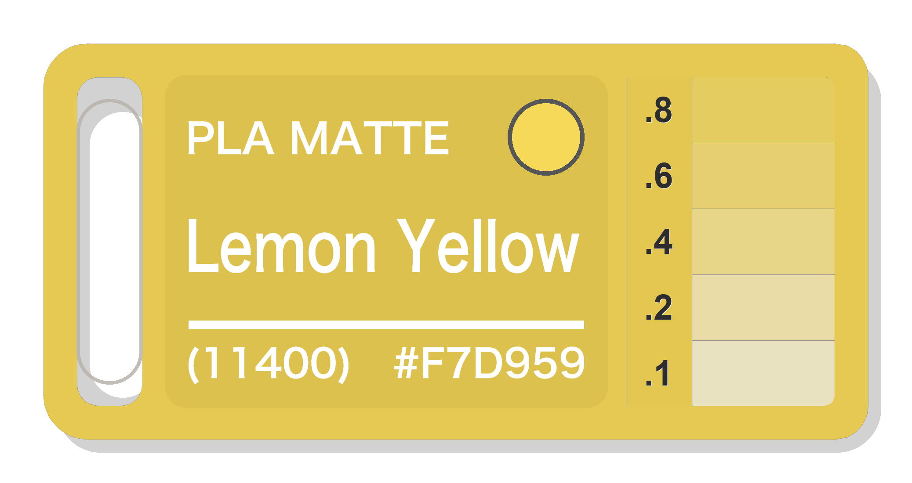

# 🎨 Bambu Lab Filament Card Studio (耗材样本卡生成器)

[](https://ziikki.github.io/filament_card/)
[](https://bambulab.com)
[](#-slicing-recommendations-bambu-studio-切片设置建议)
[](LICENSE)
[](#)

A modern, fast, and elegant web application & CLI suite to generate official-dimension 3D printable filament swatch cards for **Bambu Lab** 3D printers. 

Runs **100% client-side** in your browser — zero backend required, free deployment on **GitHub Pages**!

专为 Bambu Lab 3D 打印机打造的现代化耗材样本卡生成工具与在线 Web 应用。**100% 纯前端浏览器运行**，免服务器实时生成切片就绪的 `.3mf` 文件！

---

## 🌐 Live Demos (在线体验)

Open directly in your browser:

- 🇺🇸 **English Web App**: [https://ziikki.github.io/filament_card/](https://ziikki.github.io/filament_card/)
- 🇨🇳 **中文独立版**: [https://ziikki.github.io/filament_card/zh.html](https://ziikki.github.io/filament_card/zh.html)

*(You can also switch languages dynamically via the top-right toggle button on either page!)*

---

## 🖼️ Card Showcase (整卡渲染与效果展示)

### 1. Bambu Studio 3D 轴测切片效果 (3D Sliced Whole Card)
> 真实 3D 打印切片模型效果，展示包含挂绳通孔、0.5mm 平齐嵌色文字与 5 阶透光厚度色梯的完整卡体：

<div align="center">
  
</div>

---

### 2. 75mm × 36mm 完整卡片正面效果 (Whole Card Dimensions & Layout)
> 严格对齐 MakerWorld #70155 真实 3D 模型的几何规范：左侧为 6×26mm 圆角挂绳开孔，中间为 40.4×30.4mm 标签凹槽（含文字及色样观察孔），右侧自上而下分布 5 条横向透光测试色样（0.8 / 0.6 / 0.4 / 0.2 / 0.1 mm）及对应的 `.8`、`.6`、`.4`、`.2`、`.1` 刻度浮雕：

| 🇺🇸 PLA Wood - White Oak (13106) | 🇨🇳 PLA Wood - 白橡木 (13106) | 🍋 PLA Matte - Lemon Yellow (11400) |
| :---: | :---: | :---: |
|  |  |  |
| 🪓 [White Oak 3MF](examples/Filament_Card_White_Oak.3mf) | 🪓 [白橡木 3MF](examples/Filament_Card_白橡木.3mf) | 🍋 [Lemon Yellow 3MF](examples/Filament_Card_Lemon_Yellow.3mf) |

---

## 💡 Highlights (核心亮点)

- 💎 **Seamless 0.5 mm Flush Inlay (默认 0.5mm 丝滑平齐嵌色)**  
  Text and color swatches sit completely flush with the card body (engineered as 5 precise layers at 0.10 mm), delivering a smooth, injection-molded touch with zero rough ridges. *(Custom embossed relief up to 1.2 mm also supported).*

- 🏷️ **Official 314-Filament Database (内置 314 款拓竹官方耗材库)**  
  Instant search by color code (e.g. `13106`), material, or bilingual name (`White Oak` / `白橡木`). Exact Bambu Lab official hex colors and metadata are baked right into your `.3mf` model and slicer preview.

- 🔗 **One-Click Store URL Auto-Parser (商城链接一键解析)**  
  Paste any Bambu Lab filament store link to instantly pull the material series, all variants, and official color swatches in seconds — zero manual typing required.

- 🎯 **Bambu Studio & Prime Tower Certified (Bambu Studio 深度兼容 · 轻松双色打印)**  
  Watertight 3D geometry calibrated for **0.10 mm** layers with native Prime Tower (擦料塔) purging for crisp, bleed-free color transitions. Slices cleanly with zero warnings, and only needs 2 AMS slots to print!

- ⚡ **100% Client-Side & Zero Setup (纯前端免安装 · 即开即用)**  
  Runs entirely in your browser via Web APIs — no software to install, no backend servers, and instant real-time `.3mf` downloads.

---

## 💻 Local Usage & CLI (本地运行与命令行)

### 1. Run Web App Locally (本地运行)
If you want to run the web app locally with offline API endpoints:

```bash
# Install dependencies (opencv-python, pillow, numpy)
pip install -r requirements.txt

# Start the local server (listens on http://localhost:8088)
./start_webtool.sh
# or
python3 app.py
```

Then visit:
- English: `http://localhost:8088`
- Chinese: `http://localhost:8088/zh.html`

### 2. Generate via CLI (命令行直接生成)

```bash
# Generate English PLA Wood - White Oak (13106) with 0.5mm flush inlay
python3 make_filament_card.py "PLA WOOD" "White Oak" "(13106)" "#D6CCA3" 0.5 --preview

# Generate Chinese PLA Wood - 白橡木 (13106) with 0.5mm flush inlay
python3 make_filament_card.py "PLA WOOD" "白橡木" "(13106)" "#D6CCA3" 0.5 --preview
```

**CLI Parameters**:
- `material`: Material name, e.g. `"PLA WOOD"`, `"PLA MATTE"`
- `color`: Color name, e.g. `"White Oak"`, `"白橡木"`
- `code`: Color code, e.g. `"(13106)"`
- `hex`: Hex color code, e.g. `"#D6CCA3"`
- `relief`: [Optional] Text/swatch relief height in mm (Default: `0.5` mm for flush surface, `1.2` mm for raised relief)
- `--base-hex`: [Optional] Base card color (Default: matches target filament `#HEX`)
- `--text-hex`: [Optional] Inlay text color (Default: `"#FFFFFF"` pure white)
- `--preview`: Output high-resolution PNG render alongside the `.3mf` file
- **Default Output**: Automatically written to `filament_card/examples/Filament_Card_<Color_Name>.3mf`

---

## 🖨️ Slicing Recommendations (Bambu Studio 切片设置建议)

The generated `.3mf` file is pre-configured for Bambu Studio according to our 3-color standard:

1. **Layer Height (层高)**: **`0.10 mm`**
   - **Crucial Setting**: Both the 3MF template and slicer metadata are pre-calibrated to **`0.10 mm`**.
   - **Why `0.10 mm`?** 
     - The card's 5-step light transmission test ladder has stepped thicknesses of `0.1 mm`, `0.2 mm`, `0.4 mm`, `0.6 mm`, and `0.8 mm`. A `0.10 mm` layer height ensures that every step maps to an exact integer layer count (1, 2, 4, 6, and 8 layers), ensuring accurate translucency evaluation.
     - The 0.50 mm flush inlay corresponds to exactly **5 layers**, providing razor-sharp text contours and a perfectly smooth top surface.
2. **First Layer Height (首层层高)**: **`0.10 mm`** (pre-set in 3MF project settings).
3. **Nozzle (喷嘴)**: `0.4 mm` (standard) or `0.2 mm` (ultra detail).
4. **Filament Assignment in Bambu Studio (3-Color Standard)**:
   - `Color 1` (Filament 1): **Card Body & Step Tests** (Default: 目标样品耗材色号 `#HEX`)
   - `Color 2` (Filament 2): **Text Inlay** (Default: 纯白色 `#FFFFFF`)
   - `Color 3` (Filament 3): **Color Swatch Dot** (Default: 目标样品耗材色号 `#HEX`)
   > 💡 **Effortless 2-Color Printing with AMS (轻松双色打印)**:
   > 卡身本体（Color 1）与观察色板（Color 3）均默认采用样品色号，文字嵌色（Color 2）默认纯白。在 AMS 中只需将**槽位 1 和槽位 3 都映射到你的待测样品耗材**，将**槽位 2 映射到白色文字耗材**，即可用 2 卷耗材完成打印，无需准备第 3 卷耗材！
5. **Prime Tower (擦料塔)**: Supported and recommended for crisp multi-color transitions without color bleeding.

---

## 🙏 Acknowledgements & Remix Attribution (致谢与原作者声明)

本项目基于 MakerWorld 社区经典热门的耗材色卡设计进行 Remix 与参数化二次开发：

- 🔗 **Original 3D Model**: [打印耗材色卡 Filament Sample Card](https://makerworld.com/en/models/70155-filament-sample-card#profileId-74478) (MakerWorld Model ID: **`#70155`**, Profile ID: **`#74478`**)
- 👤 **Original Designer**: [喵喵mya](https://makerworld.com/en/@user_234900454) (@fenglyu)
- 📐 **Design Specifications**: 
  - 外轮廓：75 mm × 36 mm，厚度 2.0 mm
  - 挂绳孔：左侧 6.0 mm × 26.0 mm 圆角通孔
  - 标签凹槽：中间 40.4 mm × 30.4 mm 凹槽（深度 0.5 mm）
  - 透光色梯：右侧 5 阶横向色梯（0.8 / 0.6 / 0.4 / 0.2 / 0.1 mm）及 `.8`、`.6`、`.4`、`.2`、`.1` 刻度浮雕

非常感谢原作者 **喵喵mya** 贡献的经典卡体设计规范（并开源了 Fusion 360 F3D 模型文件）！本项目在此几何标准的基础上，实现了拓竹官网参数自动提取、浏览器纯前端实时 3MF 生成与 GitHub Pages 免服务器部署。

---

## 📄 License

MIT License. Designed with ❤️ for the 3D printing community.

---

<details>
<summary>🛠️ <b>Developer Reference & Internal Notes (开发者参考)</b></summary>

<br>

*This section is intended for maintainers and developers. For comprehensive architecture notes and detailed workflows, see **[DEVELOPMENT.md](DEVELOPMENT.md)**.*

- **Git Remote**: `https://github.com/ziikki/filament_card.git` (branch: `main`)
- **Quick Push**: `git push -u origin main`
- **Pages Workflow**: Managed automatically via `.github/workflows/deploy.yml` on push to `main`.
- **Repository Structure & Technical Pipeline**: See [DEVELOPMENT.md](DEVELOPMENT.md) for full directory breakdown, 3MF binary/XML structure, Marching Squares contouring details, and test commands.

</details>
